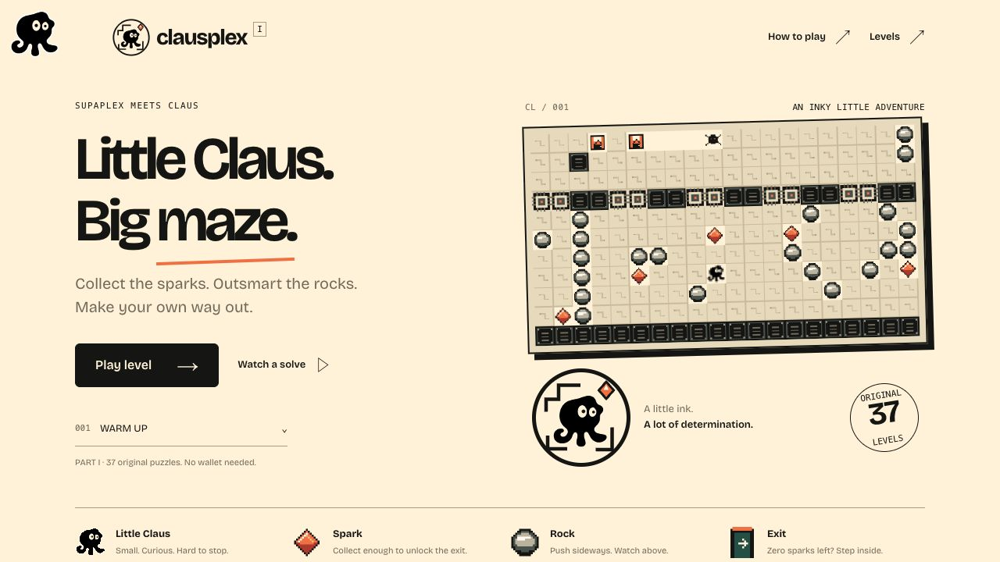

# Clausplex

Little Claus. Big maze.

A free, independent community adaptation of OpenSupaplex with Claus artwork and the original Supaplex puzzles. **All 111 original levels are included.**

[Play on Claus Network](https://claus.si/c/clausplex) · [Developer on X](https://x.com/0xlaplaced)



## Play

Collect the required sparks and find the exit. Use the arrow keys to move; hold Space and a direction to grab an adjacent object. Press P to pause and R to restart. Touch controls are available on narrow screens.

No wallet, account, installation, or payment is required to play. The game is silent and progress is not saved; choose any of the 111 puzzles from **Levels**.

The puzzle maps, collision rules, timing, and gameplay simulation are preserved. Clausplex provides a new interface, terrain artwork, and a little Claus character over the OpenSupaplex engine.

## Run locally

Python 3.10+ is enough to serve the committed static game:

```sh
python3 -m http.server 8000 --directory docs
```

Open <http://localhost:8000/>. No application dependencies or API keys are needed.

## Edit and rebuild the interface

Edit `index.html`, `app.js`, `rankings.js`, or `theme.css`, then run:

```sh
python3 scripts/rebuild-site.py
```

This reuses the committed JavaScript engine when a local C build is absent, runs `package.py`, and updates `docs/`. Keep generated `docs/` files committed as the reproducible static release bundle. The public game is published on Claus Network; this repository stores its source and build artifacts. GitHub Pages is disabled.

For changes to C code or embedded resources, activate **Emscripten 6.0.12**, then run:

```sh
python3 build-portable.py
python3 scripts/rebuild-site.py
```

See [BUILD.txt](BUILD.txt) for the complete build, resource, and upstream details. The compiled game uses pure JavaScript to work within the Claus hosting restrictions. The gzip-packed JavaScript engine downloads in parallel when Play or Watch is
selected and unpacks with the browser’s DecompressionStream API, so the menu can
open first. A current browser with streaming gzip decompression is required.

## Verify

With Node.js and Python installed:

```sh
python3 scripts/rebuild-site.py
node validate_site.mjs
node tests/test-loader.mjs
node tests/test-progression.mjs
node tests/test-browser-errors.mjs
```

For a full simulation check of all 111 original solution recordings:

```sh
python3 build-portable.py --headless
python3 test-portable.py
```

The full release is checked with all 111 original solution recordings and next-level
navigation for every level, including the final completion screen. These checks
verify the original simulation and UI routing; they are not a manual playthrough
of every puzzle.

The **Watch a solve** demonstration runs at the original 35 simulation steps per second (normal play speed). It stops on completion and does not submit a score.

## Automatic nickname leaderboard

Enter **Player name**, choose **Play level**, and finish a puzzle. The nickname is
registered on start and completed times save automatically. No wallet, sign-in,
publication checkbox or Submit step. Leave the name blank for anonymous play;
watched solves never save scores. Names carry between levels in the URL fragment.
Names and best times are public. Nicknames are display labels, not reserved or
verified accounts: matching names share one overall entry.

The result screen shows Saving, Saved or a retry action on connection failure.
A saved replay persists on the service even if the player leaves. The scheduled
GitHub verifier replays inputs in our pinned original engine before adding a time
to the table. It runs every five minutes when GitHub schedules permit; delays are
possible. This proves a valid solution, not human play. One overall table ranks
players by the number of different levels completed, then
by the sum of their best times on those levels. Repeating a level only improves
its best time; it never adds another completed level. All verified player
completions contribute to the same table. The top 50 players are shown. Time is
simulation steps / 35, excluding pauses. No prizes, token, payment or NFT integration.

The public API origin is `scoresOrigin` in `backend/deployment.json`:
`POST /players`, `POST /runs`, `GET /runs/{runId}`, and
`GET /boards` (overall rankings). The older level query remains available for
previous published clients during rollout. Only the server-side `VERIFIER_KEY` can read
the private replay queue or post verdicts; its identical Actions secret is
`CLAUS_SCORES_KEY`. The browser has no credential. Service source, schema and
regression tests are archived in `backend/public-scores/`; its canonical deployment
source uses Sites, while the game remains published on Claus. Database migrations
are deployment-only. The former Claus record queue stays supported for already
submitted runs; no new player needs that sign-in flow or its expiring credential.

Run `node tests/test-rankings.mjs` and `node tests/test-guest-verifier.mjs` for the
new UI/queue regressions. The score service tests run in its own checkout with
`node tests.mjs`. Existing `tests/test-verifier.mjs` still checks the original C
replay validation and legacy queue. Replays are capped at 4096 input bytes,
126000 steps and a 12-second verification deadline in a credential-free child
process. Score writes have daily network/name bounds, 500 queued attempts and
50,000 total attempts; raw IP addresses are not stored. Monitor these limits
before increasing them. Scores remain pending if verification is unavailable;
unverified client times never reach the leaderboard.

## Source and credits

Based on [OpenSupaplex 7.2.2](https://github.com/sergiou87/open-supaplex), upstream commit `bad56a4e174e628643995284ea55d4c49af3137c`, by Sergio Padrino and contributors. Original Supaplex by Philip Jespersen and Michael Stopp.

The OpenSupaplex engine is GPLv3; see [LICENSE](LICENSE), the preserved source headers, and [NOTICE.md](NOTICE.md). Original levels, replay recordings, legacy fonts, and Claus branding retain their respective authors' rights; the engine license does not relicense them. Bricolage Grotesque uses the SIL Open Font License. Runtime and font licenses are included in `assets/`.

This is an independent community adaptation, not an official Claus product. Maintained by [@0xlaplaced](https://x.com/0xlaplaced).
